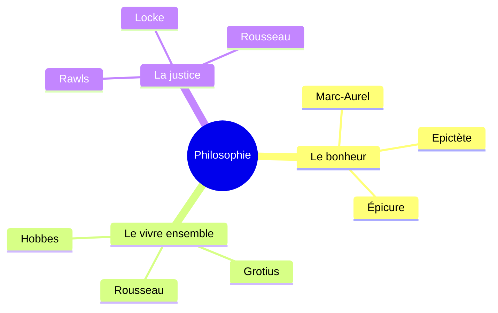
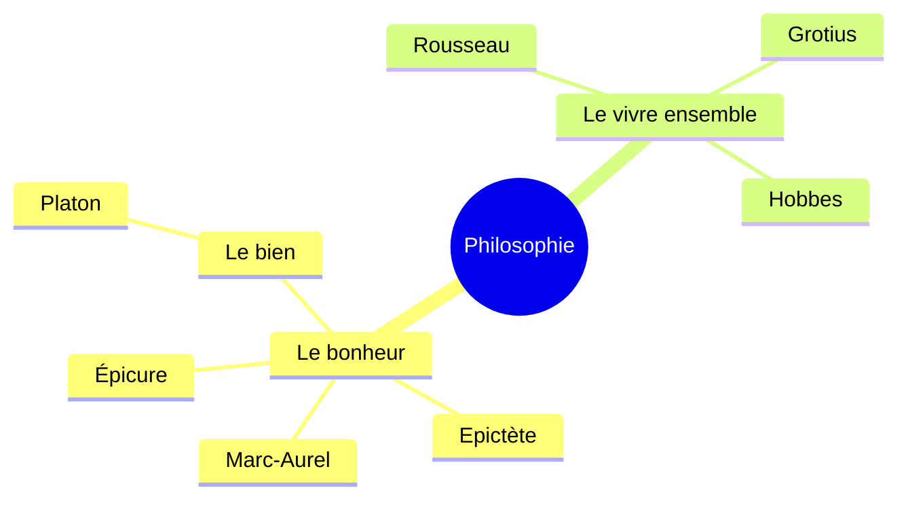
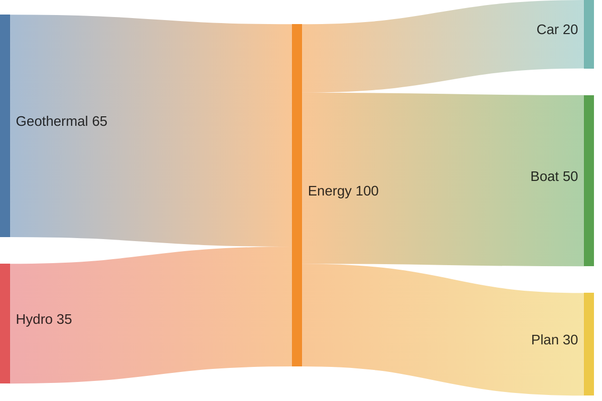

Pour l'instant je part sur le Français comme langue pour le blog après avoir pas mal hésité mais je pense c'est la meilleur dans le sens ou ça va me permettre de porter plus attention à ce que je dis plutôt qu'a comment je le dis.

Avec l'aide de chatGPT on a ajouté les équations rendues avec typst par exemple $pi$ ou bien encore $phi$

$$
f(x) = 3x^2 + 4
$$

Et je peux aussi rendre des diagrammes avec [Pele](https://x.com/kepano/status/2111472054293913749/video/2) !




Cette jolie carte mental ne m'a demandé que ceci comme code : 

````md

````



Ceci est un bloc de code avec de la couleur ! :

```python
import random

for i in range(100):
    print(f"{i} : 🎲 rolled a {random.randint(0,6)} !")
```

C'est trop chouette non ?