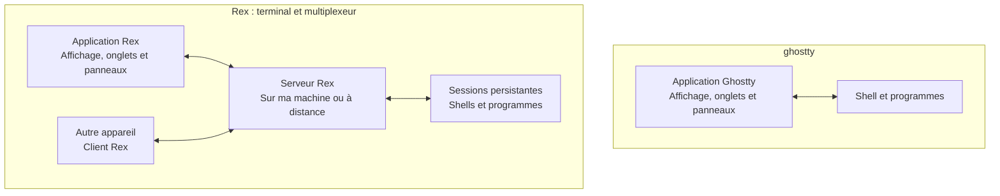

Mitchell Hashimoto a sorti un nouveau terminal appelé Rex

Mitchell Hashimoto est un des développeurs que j'admire le plus (bon, en même temps je n'en connais pas beaucoup...) il est connu pour avoir crée [Ghostty](https://ghostty.org/) qui est le terminal que j'utilisais jusqu'a maintenant et qui est un délice a utiliser. (Globalement il n'a pas de problème et il est juste agréable et fonctionne comme on s'y attendrais)

Pourquoi crée-il un nouveau terminal si il en a déjà un qui fonctionne si bien ?

(schéma crée par chatGPt)

Avec Rex je peux donc fermer l'application et les programmes tourneront toujours. Il y a égaement un client iOS de prévu et des clients Linux et Windows également.

Et en plus c'est magnifiquement crée (la patte de Mitchell mais c'est beau et agréable a utiliser même si on ne se sert pas de ses fonctionnalité principales

